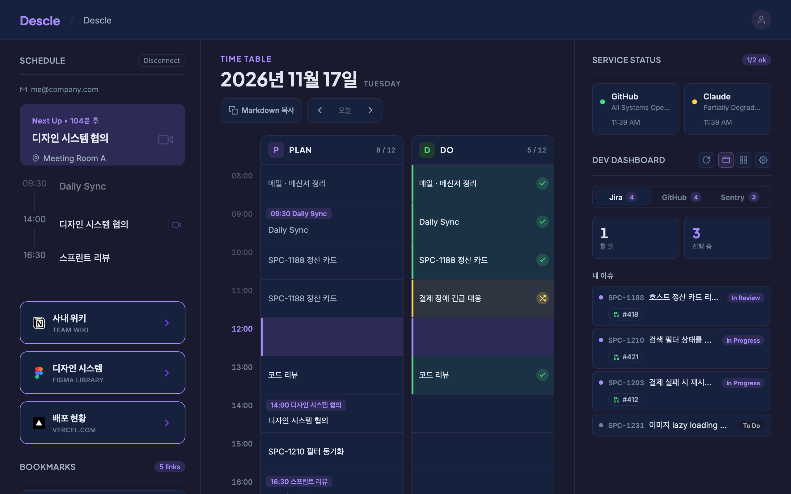
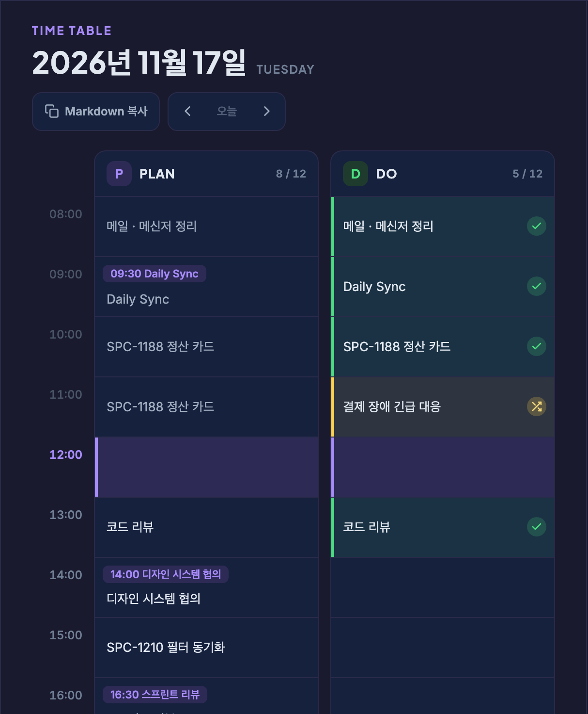
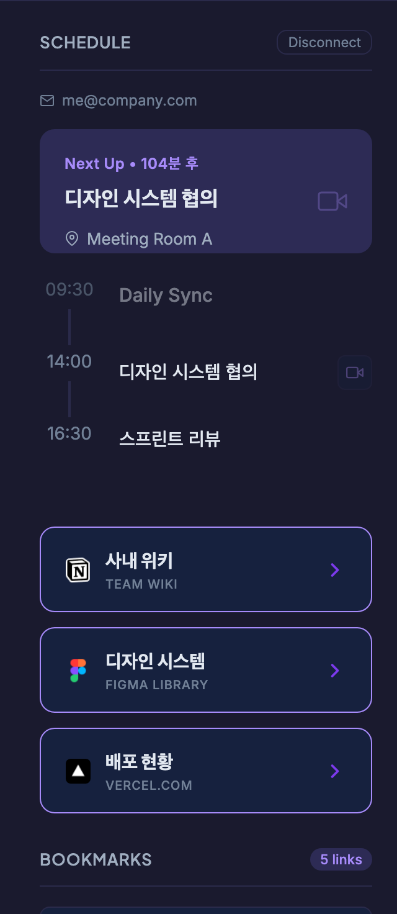
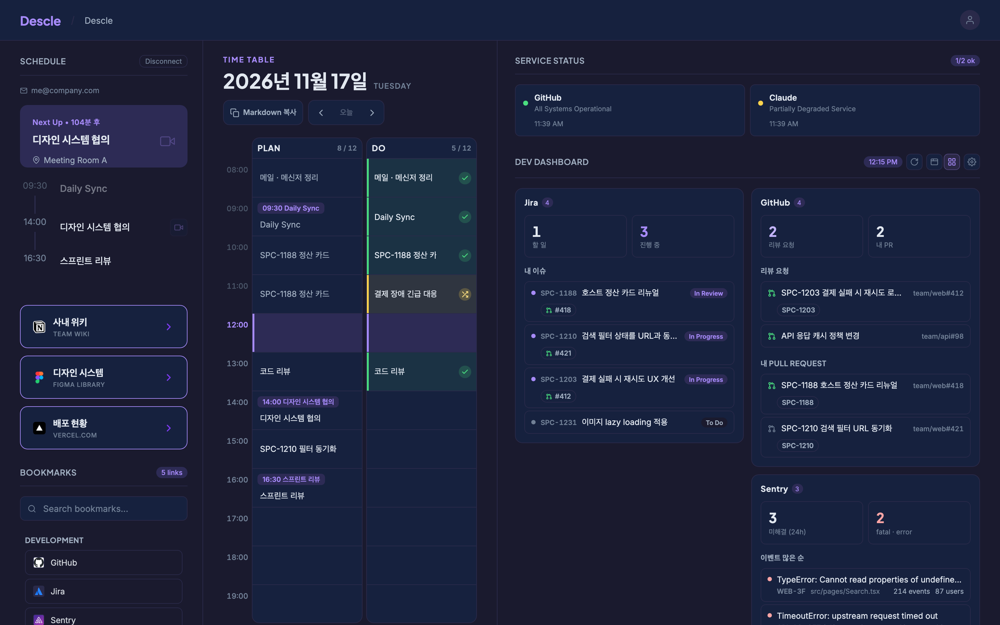

# Descle

Chrome 새 탭을 대체하는 glanceable 대시보드 확장 프로그램.  
오늘의 일정·북마크, 시간별 계획/실행, Jira·GitHub 현황을 한 화면에서 확인한다.



## Features

- **Schedule + Fast links + Bookmarks** (좌) — Google Calendar 일정, 자주 쓰는 링크 카드(최대 3개 직접 등록), 브라우저 북마크 모아보기
- **Time Table** (가운데) — 08~19시 시간별 계획(Plan) / 실행(Do) 캘린더. 컬럼 높이를 꽉 채워 표시
  - 오늘의 Google Calendar 일정을 계획 칸에 함께 표시
  - 계획과 실행이 일치하면 초록(✓), 다르거나 계획 외 실행이면 노랑(🔀)으로 구분
  - **Markdown 복사** — 하루 타임테이블을 Obsidian에 붙여넣을 수 있는 Markdown 표로 클립보드에 복사
- **Dev Dashboard** (우) — GitHub·Claude 서비스 상태 + Jira / GitHub / Sentry. Jira 내 이슈, GitHub 내 PR·리뷰 요청(PR 제목의 Jira 키로 이슈 ↔ PR 연결), Sentry 최근 24시간 미해결 이슈
  - **탭 뷰 / 카드 뷰** 전환. 카드 뷰는 컬럼 폭에 따라 1~3열 masonry 배치
- **Resizable columns** — 드래그로 3컬럼 비율 조정, localStorage에 저장
- **Dark mode** — system / light / dark 3-way 토글, OS preference 실시간 반영

## Screenshots

| Time Table | Fast links |
|---|---|
|  |  |

**Dev Dashboard — 카드 뷰** (우측 컬럼을 넓힌 상태)



## Tech Stack

| Layer | Choice |
|-------|--------|
| Runtime | Chrome Extension (Manifest V3) |
| UI | React 19 + TypeScript |
| Build | Vite + @crxjs/vite-plugin |
| Styling | CSS custom properties (design tokens) |
| Storage | chrome.storage.local + localStorage |
| Auth | Chrome Identity API (OAuth2 → Google Calendar) |

## Getting Started

```bash
# 의존성 설치
npm install

# 개발 서버 (HMR)
npm run dev

# 프로덕션 빌드
npm run build
```

### Chrome에 로드

1. `chrome://extensions` 접속
2. "개발자 모드" 활성화
3. "압축해제된 확장 프로그램을 로드합니다" → `dist/` 폴더 선택

## Project Structure

```
src/
├── App.tsx              # 메인 레이아웃, 컬럼 리사이즈, 테마 토글
├── index.tsx            # newtab entry
├── options-entry.tsx    # options page entry
├── Options.tsx          # 설정 페이지 (Quick Links 관리)
├── types.ts             # 공통 타입 정의
├── components/
│   ├── Schedule.tsx     # 캘린더 일정 패널
│   ├── FastLinks.tsx    # 사용자 등록 Fast link 카드 (최대 3개)
│   ├── QuickLinks.tsx   # 북마크 패널
│   ├── TimeTable.tsx    # 시간별 계획/실행 타임테이블 + Markdown 추출
│   ├── ServiceStatus.tsx# 서비스 상태
│   └── DevDashboard.tsx # Jira · GitHub · Sentry 대시보드 (탭/카드 뷰)
���── hooks/
│   └── useChromeStorage.ts
├── services/
│   ├── storage.ts       # chrome.storage 래퍼 (제네릭 getItem/setItem)
│   ├── calendar.ts      # 일정 유틸 함수
│   └── devDashboard.ts  # Jira / GitHub / Sentry API
└── styles/
    ├── tokens.css       # 디자인 토큰 (light + dark)
    └── layout.css       # 글로벌 레이아웃
```

## Permissions

| Permission | 용도 |
|------------|------|
| `identity` | Google OAuth2 로그인 |
| `storage` | 타임테이블 기록, Fast link, 일정 캐시, 설정 저장 |
| `alarms` | 백그라운드 캘린더 동기화 |
| `bookmarks` | 북마크 읽기/쓰기 |
| `api.github.com`, `*.atlassian.net`, `sentry.io` (optional) | Dev 대시보드. 연동 저장 시에만 요청 |

## Publishing

`main` 브랜치 push 시 Chrome Web Store에 자동 업로드하고 심사를 요청할 수 있습니다. 최초 1회 설정은 [자동 배포 가이드](docs/web-store-publishing.md)를 참고하세요.

## License

Private
